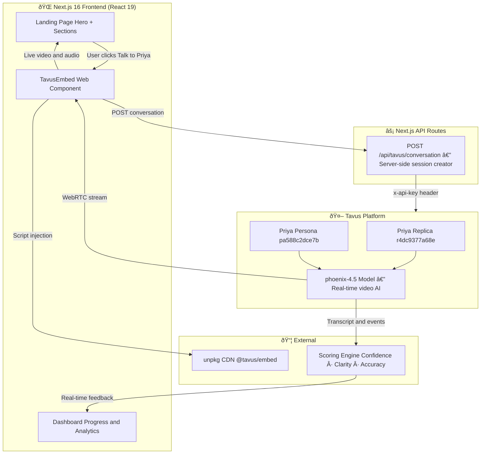
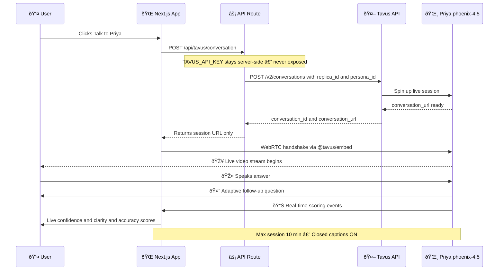
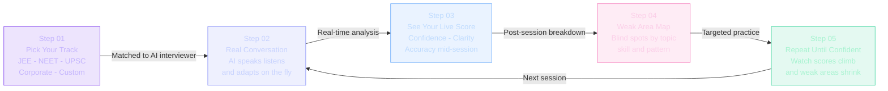
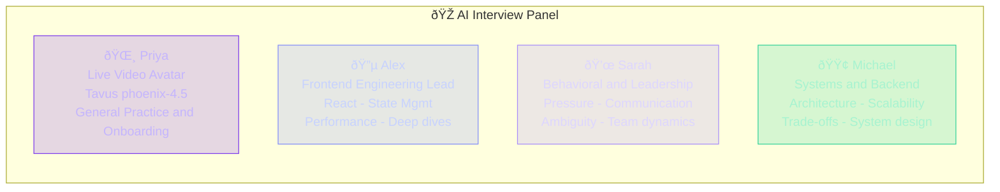
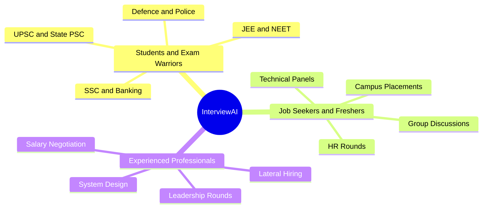
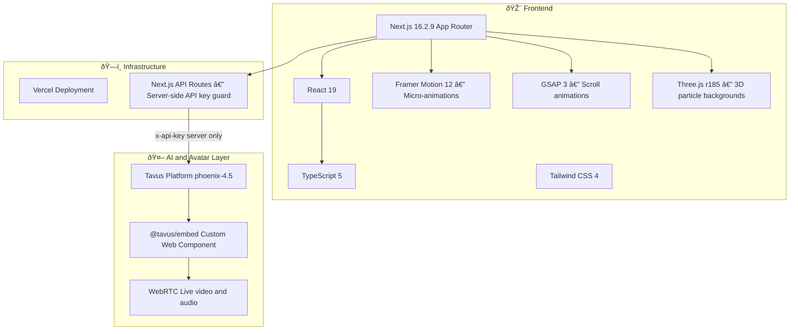
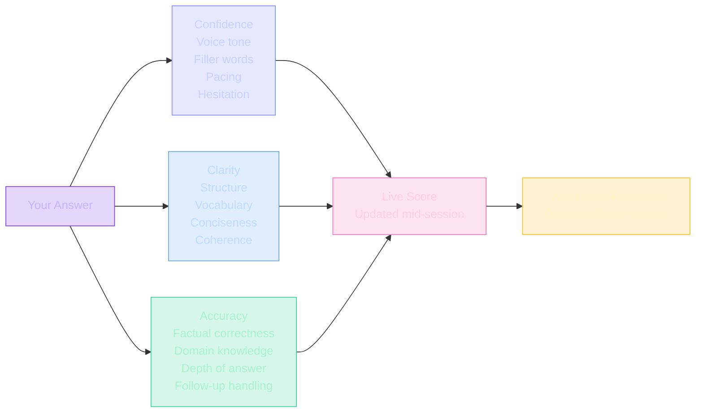

<div align="center">


<br/>


> **The world's most realistic AI interview practice platform — powered by a live video avatar that speaks, listens, and adapts in real time.**

</div>

---

## 🎙️ Meet Priya — Your Live AI Interviewer

<div align="center">

<br/>


<br/><br/>

> **🌸 Priya** · Powered by [Tavus](https://tavus.io) `phoenix-4.5` · Real-time video AI · Speaks · Listens · Adapts

<br/>

[](https://interview-ai-n.vercel.app)

<br/>

> **No sign-up needed.** Click above → Priya appears on screen, greets you, and starts the interview live.

<br/>

| 🎥 Live video avatar | Real-time WebRTC — she's on screen, face-to-face |
|:---|:---|
| 🎤 She actually hears you | Speaks and listens exactly like a real interviewer |
| 🧠 Fully adaptive | Every follow-up question depends on your last answer |
| 📊 Live scoring | Confidence · Clarity · Accuracy updated mid-session |
| 🗺️ Post-session roadmap | Know exactly what to fix after every interview |

<br/>

</div>

---

## 📋 Table of Contents

- [What is InterviewAI?](#-what-is-interviewai)
- [Features](#-features)
- [Architecture](#-architecture)
- [How It Works](#-how-it-works)
- [User Journey](#-user-journey)
- [AI Interviewers](#-ai-interviewers)
- [Who Is It For?](#-who-is-it-for)
- [Tech Stack](#-tech-stack)
- [Project Structure](#-project-structure)
- [Getting Started](#-getting-started)
- [Tavus Embed Code](#-tavus-avatar-embed-code)
- [Scoring System](#-scoring-system)
- [Pricing](#-pricing)
- [Environment Variables](#-environment-variables)
- [Contributing](#-contributing)

---

## 🎯 What is InterviewAI?

**InterviewAI** is an AI-powered interview practice platform that uses **live photorealistic video avatars** (powered by [Tavus](https://tavus.io) `phoenix-4.5`) to simulate hyper-realistic interview experiences.

Unlike text-based chatbots, InterviewAI's avatars:

- 🗣️ **Speak aloud** in a natural human voice
- 👁️ **Maintain eye contact** and realistic facial expressions
- 🧠 **Adapt dynamically** — every follow-up depends on your last answer
- 📊 **Score you in real-time** on Confidence · Clarity · Accuracy
- 🗺️ **Generate personalised roadmaps** to fix your exact weak spots

---

## ✨ Features

| Feature | Description |
|---|---|
| 🎤 **Voice Interview** | Speak naturally; AI evaluates like a real panel |
| 🤖 **Live AI Avatar (Priya)** | Photorealistic interviewer via Tavus phoenix-4.5 |
| 📄 **Resume Review** | Strengths and gap analysis before you even start |
| 💼 **LinkedIn Review** | See exactly how recruiters read your profile |
| âš¡ **Adaptive Questions** | Every follow-up depends on what you just said |
| 🏢 **Company-Specific** | Practice the exact format used by top companies |
| 📈 **Progress Tracking** | Every session logged, scored, and compared |
| 🗺️ **Weak Area Roadmaps** | Precise next steps — not generic advice |
| 🤖 **AI Coach** | Always-on assistant reviewing cross-session patterns |
| 📊 **Live Scoring** | Confidence, clarity and accuracy — updated mid-interview |

---

## 🏗️ Architecture



---

## 🔄 How It Works — Sequence Diagram



---

## 🔄 User Journey — 5 Steps to Confidence



---

## 🤖 AI Interviewers



> **Priya** is the only fully photorealistic, real-time video AI — she literally sees and speaks with you via WebRTC.

---

## 👥 Who Is It For?



---

## 🧩 Tech Stack



---

## 📁 Project Structure

```
interview-ai/
├── src/
│   ├── app/
│   │   ├── api/
│   │   │   └── tavus/
│   │   │       └── conversation/
│   │   │           └── route.ts        ← Server-side Tavus session creator
│   │   ├── dashboard/
│   │   │   └── page.tsx                ← User progress dashboard
│   │   ├── login/                      ← Auth pages
│   │   ├── register/
│   │   ├── onboarding/                 ← Onboarding flow
│   │   ├── layout.tsx
│   │   └── page.tsx                    ← Landing page assembly
│   │
│   └── components/
│       ├── sections/
│       │   ├── Hero.tsx                ← Main hero with Priya embed
│       │   ├── TavusEmbed.tsx          ← Tavus web component wrapper
│       │   ├── Features.tsx            ← 8-feature grid
│       │   ├── HowItWorks.tsx          ← 5-step GSAP timeline
│       │   ├── ForWhom.tsx             ← Audience cards
│       │   ├── AIInterviewers.tsx      ← Interviewer profiles
│       │   ├── Pricing.tsx             ← 3-tier pricing
│       │   ├── Testimonials.tsx        ← Social proof
│       │   ├── SkillsTracker.tsx       ← Skills visualization
│       │   ├── AnalyticsPreview.tsx    ← Dashboard preview
│       │   ├── CareerCategories.tsx    ← Exam/career categories
│       │   ├── Interviewshowcase.tsx   ← Live demo showcase
│       │   ├── ThreeBackground.tsx     ← Three.js particle bg
│       │   ├── Navbar.tsx              ← Navigation
│       │   └── Footer.tsx              ← Footer
│       │
│       └── ui/
│           ├── PriyaLiveAvatar.tsx     ← Priya portrait component
│           ├── Button.tsx
│           ├── Container.tsx
│           └── Eyebrow.tsx
│
├── public/
├── avatar-engine/
├── tavus-interviewer/
├── .env.local                          ← Environment variables (git-ignored)
├── next.config.ts
└── package.json
```

---

## 🚀 Getting Started

### Prerequisites

- **Node.js** `>=18.0.0`
- A [Tavus](https://platform.tavus.io) account and API key

### 1. Clone

```bash
git clone https://github.com/SurinderTech/interview-ai.git
cd interview-ai
```

### 2. Install

```bash
npm install
```

### 3. Configure `.env.local`

```env
# Server-side only — never expose this to the client
TAVUS_API_KEY=your_tavus_api_key_here

# Priya identifiers (safe to expose as NEXT_PUBLIC_)
NEXT_PUBLIC_TAVUS_REPLICA_ID=r4dc9377a68e
NEXT_PUBLIC_TAVUS_PERSONA_ID=pa588c2dce7b
```

### 4. Run Dev Server

```bash
npm run dev
```

Open [http://localhost:3000](http://localhost:3000) — Priya will be live!

### 5. Build for Production

```bash
npm run build
npm start
```

---

## 🔌 Tavus Avatar Embed Code

### Plain HTML — works on any website

```html
<!-- Load Tavus embed script once per page -->
<script src="https://unpkg.com/@tavus/embed@latest" async></script>

<!-- Place the avatar anywhere -->
<tavus-embed
  deployment-id="d52984b7-a661-42b8-a956-69ac7d268d1d"
  style="width:100%;max-width:780px;height:500px;display:block;border-radius:24px;"
></tavus-embed>
```

### React / Next.js Component

```tsx
import { TavusEmbed } from "@/components/sections/TavusEmbed";

// Uses Priya's deployment ID by default
<TavusEmbed className="w-full h-[500px] rounded-3xl" />

// Explicit IDs
<TavusEmbed
  deploymentId="d52984b7-a661-42b8-a956-69ac7d268d1d"
  personaId="pa588c2dce7b"
  className="w-full h-[500px] rounded-3xl"
/>
```

### Priya's IDs

| Field | Value |
|---|---|
| Deployment ID | `d52984b7-a661-42b8-a956-69ac7d268d1d` |
| Replica ID | `r4dc9377a68e` |
| Persona ID | `pa588c2dce7b` |
| Model | `phoenix-4.5` |
| Max Session | 10 minutes |
| Closed Captions | Enabled |

---

## 📊 Scoring System



---

## 💰 Pricing

| Plan | Price | Interviews | Highlights |
|---|---|---|---|
| Free | $0 / forever | 3 per month | Basic scoring, 1 AI interviewer |
| Pro | $24 / month | Unlimited | Full analytics, all AIs, resume and LinkedIn review, company-specific |
| Enterprise | Custom | Unlimited | Everything in Pro plus team dashboards, cohort analytics, dedicated support |

---

## 🌐 Environment Variables

| Variable | Required | Client-Safe | Description |
|---|---|---|---|
| `TAVUS_API_KEY` | Yes | No — server only | Your Tavus platform API key |
| `NEXT_PUBLIC_TAVUS_REPLICA_ID` | Yes | Yes | Priya replica ID (phoenix-4.5) |
| `NEXT_PUBLIC_TAVUS_PERSONA_ID` | Yes | Yes | Priya persona/character ID |

> `TAVUS_API_KEY` is handled in `/api/tavus/conversation` (server-side only) and never forwarded to the browser.

---

## 🤝 Contributing

```bash
git checkout -b feat/your-feature
git commit -m "feat: describe your change"
git push origin feat/your-feature
```

Commit convention: `feat:` `fix:` `docs:` `chore:` `refactor:`

---

<div align="center">

**Stop reading. Start practicing.**

[](https://interview-ai-n.vercel.app)

*Built for students, job seekers and professionals who refuse to walk into an interview unprepared.*

</div>
