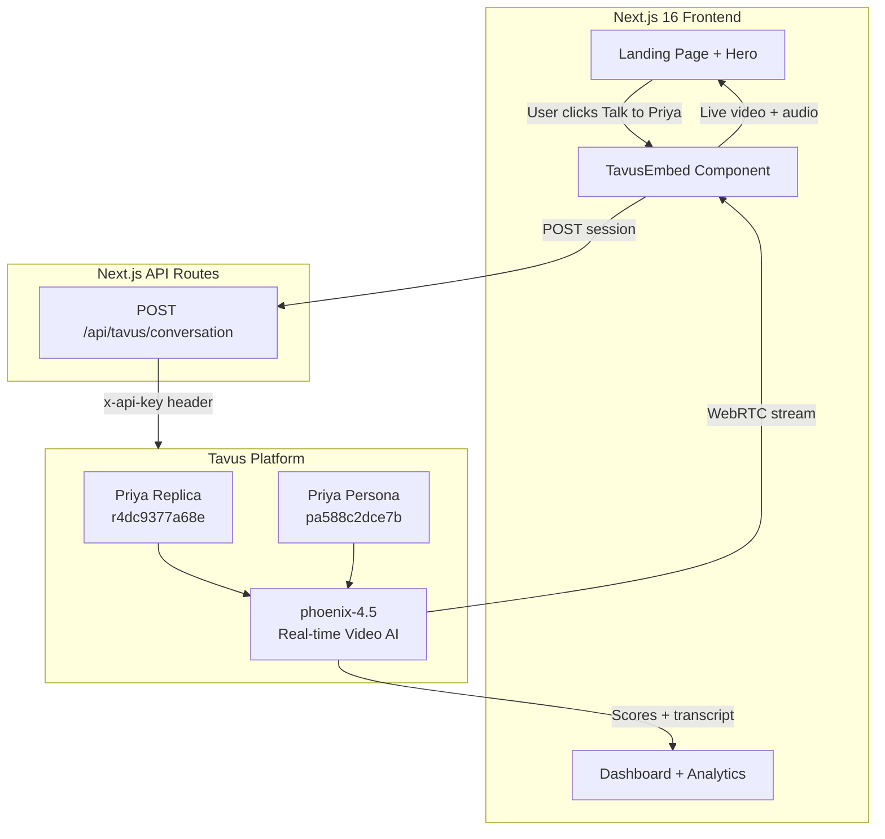
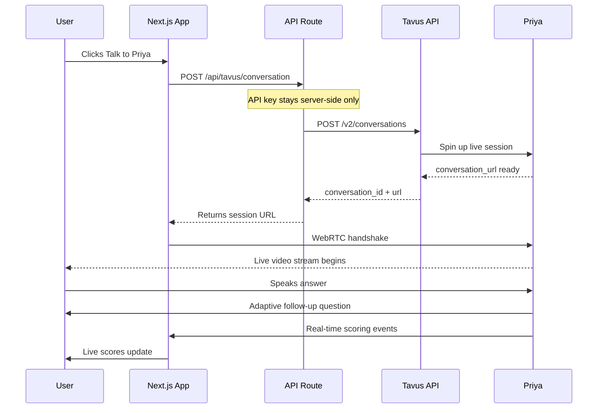
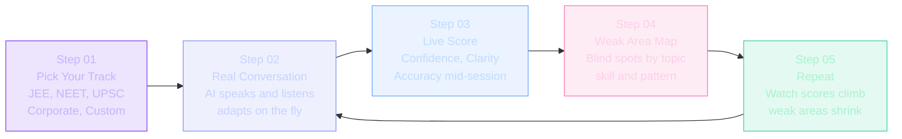
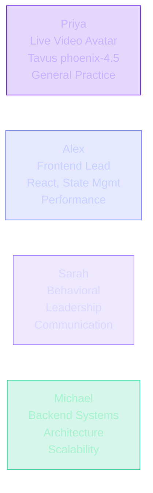
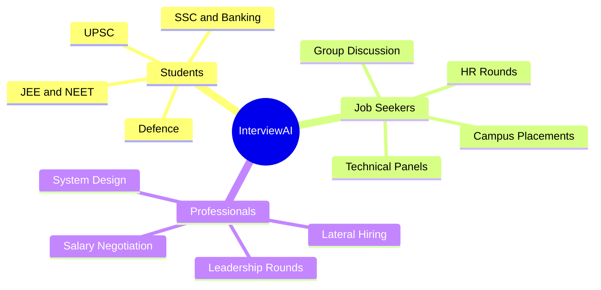
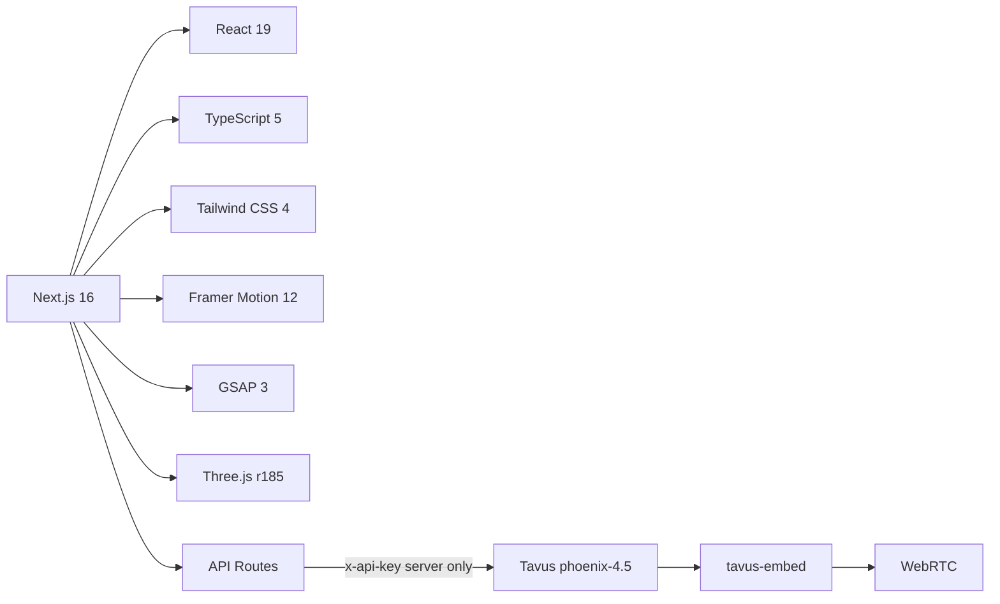
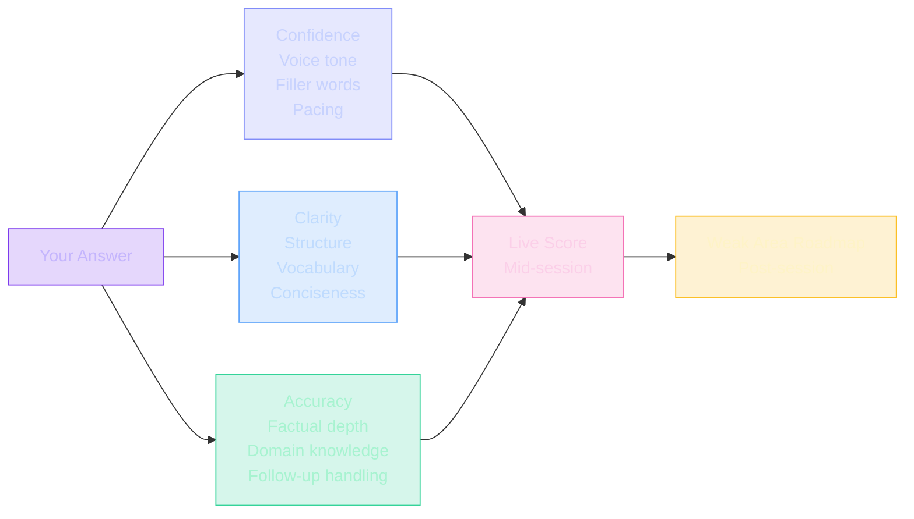

<div align="center">


<br/>


> **The world's most realistic AI interview practice platform — powered by a live video avatar that speaks, listens, and adapts in real time.**

</div>

---

## Meet Priya — Your Live AI Interviewer

<div align="center">

<br/>


<br/><br/>

**Priya** &nbsp;|&nbsp; Powered by [Tavus](https://tavus.io) `phoenix-4.5` &nbsp;|&nbsp; Real-time WebRTC Video AI

<br/>

[](https://interview-ai-n.vercel.app)

<br/>

**No sign-up needed.** Click above — Priya appears on screen and the interview starts live.

<br/>

| | |
|:---|:---|
| Live video avatar | Real-time WebRTC — she is on screen, face-to-face |
| She hears you | Speaks and listens exactly like a real interviewer |
| Fully adaptive | Every follow-up depends on your last answer |
| Live scoring | Confidence, Clarity, Accuracy updated mid-session |
| Post-session roadmap | Know exactly what to fix after every interview |

</div>

---

## Table of Contents

- [What is InterviewAI?](#what-is-interviewai)
- [Features](#features)
- [Architecture](#architecture)
- [How It Works](#how-it-works)
- [User Journey](#user-journey)
- [AI Interviewers](#ai-interviewers)
- [Who Is It For?](#who-is-it-for)
- [Tech Stack](#tech-stack)
- [Project Structure](#project-structure)
- [Getting Started](#getting-started)
- [Tavus Embed Code](#tavus-avatar-embed-code)
- [Scoring System](#scoring-system)
- [Pricing](#pricing)
- [Environment Variables](#environment-variables)
- [Contributing](#contributing)

---

## What is InterviewAI?

**InterviewAI** is an AI-powered interview practice platform that uses **live photorealistic video avatars** (powered by [Tavus](https://tavus.io) `phoenix-4.5`) to simulate hyper-realistic interview experiences.

Unlike text-based chatbots, InterviewAI avatars:

- Speak aloud in a natural human voice
- Maintain eye contact and realistic facial expressions
- Adapt dynamically — every follow-up depends on your last answer
- Score you in real-time on Confidence, Clarity and Accuracy
- Generate personalised roadmaps to fix your exact weak spots

---

## Features

| Feature | Description |
|---|---|
| Voice Interview | Speak naturally; AI evaluates like a real panel |
| Live AI Avatar (Priya) | Photorealistic interviewer via Tavus phoenix-4.5 |
| Resume Review | Strengths and gap analysis before you even start |
| LinkedIn Review | See exactly how recruiters read your profile |
| Adaptive Questions | Every follow-up depends on what you just said |
| Company-Specific Prep | Practice the exact format used by top companies |
| Progress Tracking | Every session logged, scored and compared |
| Weak Area Roadmaps | Precise next steps — not generic advice |
| AI Coach | Always-on assistant reviewing cross-session patterns |
| Live Scoring | Confidence, clarity and accuracy updated mid-interview |

---

## Architecture



---

## How It Works



---

## User Journey



---

## AI Interviewers



> **Priya** is the only fully photorealistic real-time video AI — she sees and speaks with you live via WebRTC.

---

## Who Is It For?



---

## Tech Stack



---

## Project Structure

```
interview-ai/
├── src/
│   ├── app/
│   │   ├── api/tavus/conversation/
│   │   │   └── route.ts          ← Server-side session creator
│   │   ├── dashboard/page.tsx    ← User progress dashboard
│   │   ├── login/                ← Auth pages
│   │   ├── onboarding/           ← Onboarding flow
│   │   └── page.tsx              ← Landing page
│   │
│   └── components/
│       ├── sections/
│       │   ├── Hero.tsx          ← Hero with Priya embed
│       │   ├── TavusEmbed.tsx    ← Tavus web component
│       │   ├── HowItWorks.tsx    ← 5-step GSAP timeline
│       │   ├── Features.tsx      ← 8-feature grid
│       │   ├── ForWhom.tsx       ← Audience cards
│       │   ├── AIInterviewers.tsx
│       │   ├── Pricing.tsx
│       │   └── SkillsTracker.tsx
│       └── ui/
│           ├── PriyaLiveAvatar.tsx
│           ├── Button.tsx
│           └── Container.tsx
│
└── public/media/
    └── Confident Corporate Woman in Modern Office.png
```

---

## Getting Started

### Prerequisites

- Node.js 18+
- [Tavus](https://platform.tavus.io) account and API key

### 1. Clone

```bash
git clone https://github.com/SurinderTech/interview-ai.git
cd interview-ai
```

### 2. Install

```bash
npm install
```

### 3. Configure .env.local

```env
# Server-side only — never expose to the client
TAVUS_API_KEY=your_tavus_api_key_here

# Priya identifiers (safe to expose)
NEXT_PUBLIC_TAVUS_REPLICA_ID=r4dc9377a68e
NEXT_PUBLIC_TAVUS_PERSONA_ID=pa588c2dce7b
```

### 4. Run

```bash
npm run dev
```

Open [http://localhost:3000](http://localhost:3000) — Priya will be live.

---

## Tavus Avatar Embed Code

### Plain HTML

```html
<!-- Load once per page -->
<script src="https://unpkg.com/@tavus/embed@latest" async></script>

<!-- Drop anywhere -->
<tavus-embed
  deployment-id="d52984b7-a661-42b8-a956-69ac7d268d1d"
  style="width:100%;max-width:780px;height:500px;display:block;border-radius:24px;"
></tavus-embed>
```

### React / Next.js

```tsx
import { TavusEmbed } from "@/components/sections/TavusEmbed";

<TavusEmbed className="w-full h-[500px] rounded-3xl" />
```

### Priya's IDs

| Field | Value |
|---|---|
| Deployment ID | `d52984b7-a661-42b8-a956-69ac7d268d1d` |
| Replica ID | `r4dc9377a68e` |
| Persona ID | `pa588c2dce7b` |
| Model | `phoenix-4.5` |
| Max Session | 10 minutes |
| Closed Captions | Enabled |

---

## Scoring System



---

## Pricing

| Plan | Price | Interviews | What You Get |
|---|---|---|---|
| Free | $0 / forever | 3 per month | Basic scoring, 1 AI interviewer |
| Pro | $24 / month | Unlimited | Full analytics, all AIs, resume + LinkedIn review, company-specific |
| Enterprise | Custom | Unlimited | Everything in Pro + team dashboards, cohort analytics, dedicated support |

---

## Environment Variables

| Variable | Required | Client-Safe | Description |
|---|---|---|---|
| `TAVUS_API_KEY` | Yes | No — server only | Your Tavus platform API key |
| `NEXT_PUBLIC_TAVUS_REPLICA_ID` | Yes | Yes | Priya replica ID |
| `NEXT_PUBLIC_TAVUS_PERSONA_ID` | Yes | Yes | Priya persona ID |

> `TAVUS_API_KEY` is handled server-side in `/api/tavus/conversation` and never forwarded to the browser.

---

## Contributing

```bash
git checkout -b feat/your-feature
git commit -m "feat: describe your change"
git push origin feat/your-feature
```

Commit convention: `feat` `fix` `docs` `chore` `refactor`

---

<div align="center">

**Stop reading. Start practicing.**

[](https://interview-ai-n.vercel.app)

*Built for students, job seekers and professionals who refuse to walk into an interview unprepared.*

</div>
